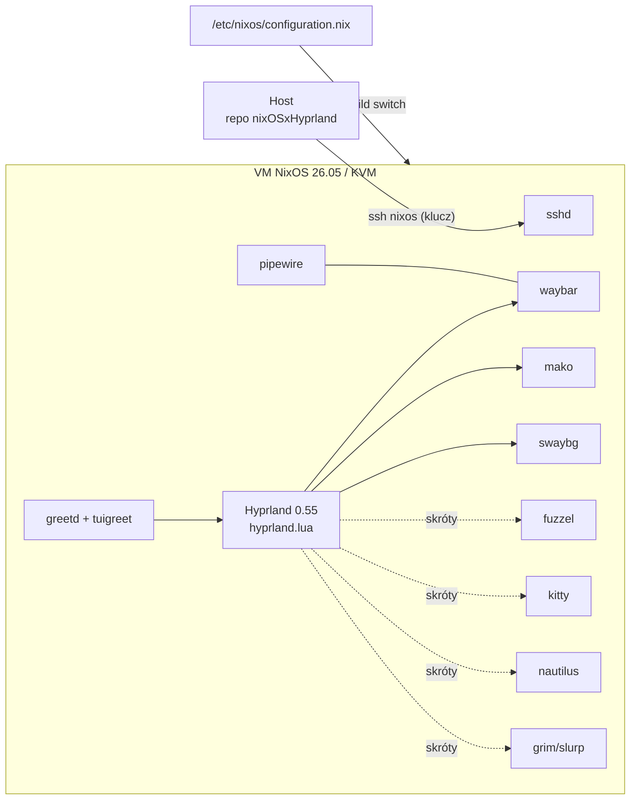

# nixOSxHyprland

## Dane podstawowe

| | |
|---|---|
| IP | 192.168.122.154/24 (sieć `default` libvirt, NAT) |
| MAC | 52:54:00:0c:cb:b0 (`enp1s0`) |
| Logowanie | `ssh nixos` → `lank@192.168.122.154`, tylko klucz ed25519; lokalnie greetd/tuigreet |
| Lokalizacja | VM KVM/QEMU na stacji roboczej; 2 vCPU, 3,8 GiB RAM, dysk `vda` 40 GB (ESP 1 GB vfat + 39 GB ext4) |

Testowa VM z **NixOS 26.05 (Yarara)** i **Hyprland 0.55.4**. Służy do przygotowania konfiguracji przed migracją prywatnego laptopa z Debiana.

Plan rozbudowy: [docs/roadmap.md](docs/roadmap.md).

## Komponenty

| Warstwa | Komponent | Konfiguracja |
|---|---|---|
| System | NixOS 26.05, systemd-boot, NetworkManager | `nixos/configuration.nix` |
| Logowanie | greetd + tuigreet → `start-hyprland` | `services.greetd` |
| Kompozytor | Hyprland 0.55.4 (config Lua), XWayland | `dotfiles/.config/hypr/hyprland.lua` |
| Pasek | waybar | `dotfiles/.config/waybar/` |
| Launcher | fuzzel (SUPER+D); wofi zainstalowane, nieużywane | |
| Powiadomienia | mako | autostart |
| Tapeta | swaybg (`~/tapeta.jpg`) | autostart |
| Zrzuty ekranu | grim + slurp → wl-copy (Print, SHIFT+Print) | |
| Pliki | nautilus (SUPER+E), yazi (TUI) | |
| Terminal | kitty | |
| Dźwięk | pipewire + pulse | `services.pipewire` |
| Edytor | vim (domyślny) | `programs.vim`, `dotfiles/.vimrc` |
| Dostęp | OpenSSH, bez roota, bez haseł | `services.openssh` |



## Szybki start

```bash
ssh nixos                                   # dostęp do VM
sudoedit /etc/nixos/configuration.nix       # zmiana konfiguracji (vim z ~/.vimrc użytkownika)
sudo nixos-rebuild switch                   # zastosowanie zmian (nowa generacja)
```

- Program bez modułu dopisz do `environment.systemPackages`. Gdy istnieje moduł `programs.X` lub `services.X` (sprawdź na [search.nixos.org/options](https://search.nixos.org/options)), użyj modułu.
- `hyprland.lua` przeładowuje się automatycznie po zapisie. Zmiany w autostarcie (`hl.on("hyprland.start", …)`) działają dopiero po ponownym zalogowaniu.

## Backup i odtwarzanie

- **Konfiguracja** jest w repo:

  | Katalog w repo | Źródło w VM |
  |---|---|
  | `nixos/` | `/etc/nixos/` |
  | `dotfiles/` | `~` (ta sama struktura: `dotfiles/.config/hypr/` = `~/.config/hypr/` itd.) |

  Odświeżenie kopii z hosta (nowy program: dopisz jego katalog do listy w `tar`):
  ```bash
  scp nixos:/etc/nixos/{configuration,hardware-configuration}.nix nixos/
  ssh nixos 'cd ~ && tar cf - --exclude="*.swp" .config/hypr .config/waybar .config/kitty .vimrc' | tar xf - -C dotfiles
  ```
- **Wycofanie zmiany systemu:** wybierz poprzednią generację w menu systemd-boot albo uruchom `sudo nixos-rebuild switch --rollback`.
- `hardware-configuration.nix` dotyczy tej VM. Na laptopie wygeneruj własny (`nixos-generate-config`).
- Dane użytkownika w VM nie są archiwizowane, bo to środowisko testowe.

## Troubleshooting

| Objaw | Przyczyna / rozwiązanie |
|---|---|
| `nixos-rebuild`: assertion „defaultEditor requires programs.vim.enable” | Ustaw `programs.vim = { enable = true; defaultEditor = true; };` |
| `sudo vim` bez kolorowania składni po podlinkowaniu `.vimrc` do `/root` | Gdy istnieje vimrc, vim nie wczytuje `defaults.vim`. Dodaj `syntax on` do vimrc. Pliki systemowe edytuj przez `sudoedit`. |
| Rozdzielczość 800x600 w VM | Ustaw tryb w bloku `hl.monitor({ … mode = "1920x1080@60", scale = 1 })`. Dostępne tryby: `hyprctl monitors` lub `cat /sys/class/drm/card*-*/modes` |
| Nie ma `hyprland.conf` | Hyprland ≥0.55 używa `hyprland.lua`, a składnia hyprlang jest przestarzała. |
| Czarny ekran po zmianie greetd | Przełącz na inny TTY (Ctrl+Alt+F2, w virt-managerze „Send key”) albo wybierz poprzednią generację w bootloaderze. |
| Kopiowanie tekstu host↔VM | Wspólny schowek nie jest skonfigurowany. Używaj `ssh nixos` i `scp`. |
